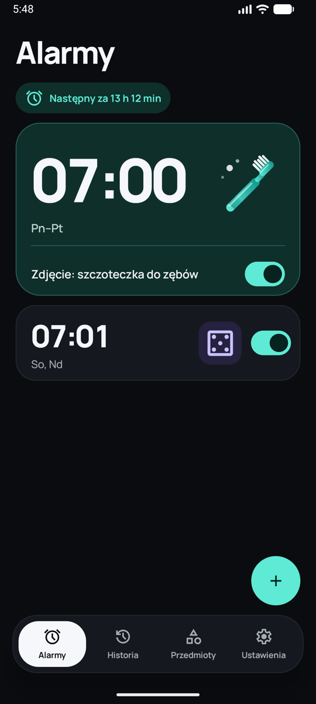
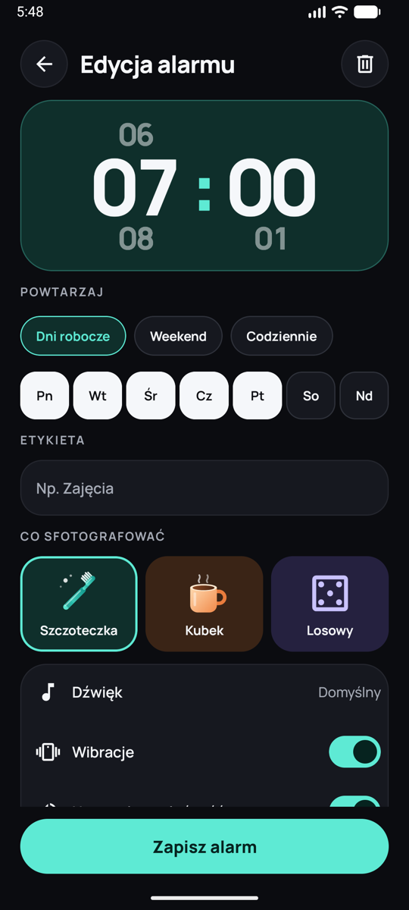
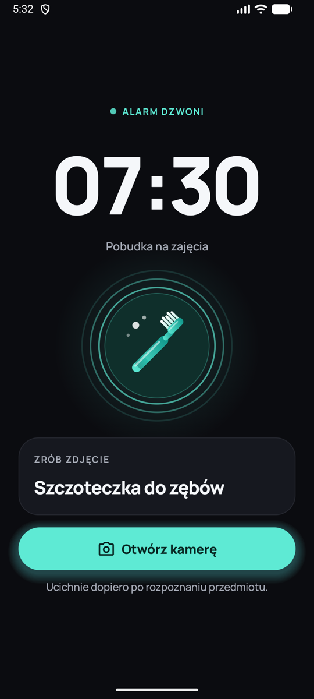

# ShotClock – inteligentny budzik

Budzik na Androida, który **przestaje dzwonić dopiero wtedy, gdy zrobisz zdjęcie wskazanego przedmiotu**, na przykład szczoteczki do zębów albo kubka. Żeby go wyłączyć, trzeba wstać z łóżka i znaleźć ten przedmiot. Drzemki nie ma, i to celowo.

Przedmiot rozpoznaje model AI, który działa **lokalnie na telefonie, bez internetu**. Zdjęcia są analizowane w pamięci i nigdy nie trafiają na dysk.

> Projekt studencki na zajęcia „Aplikacje Mobilne”. Aplikacja jest w budowie: ukończone są Etapy 1 i 2 (szczegóły w sekcji [Plan budowy](#plan-budowy)).

## Zrzuty ekranu

| Lista alarmów | Edycja alarmu | Ekran dzwonienia | Przedmioty | Historia |
|:---:|:---:|:---:|:---:|:---:|
|  |  |  |  |  |

Zrzuty z emulatora Android Studio. Lista i edycja alarmów działają na prawdziwej bazie danych. Ekrany dzwonienia, przedmiotów i historii pokazują na razie przykładowe dane (podłączymy je w kolejnych etapach).

## Jak to działa

1. Ustawiasz alarm: godzinę, dni tygodnia, etykietę i przedmiot, który trzeba będzie sfotografować (szczoteczka, kubek albo losowy).
2. Alarm dzwoni na pełnym ekranie, także przy zablokowanym telefonie. Na ekranie widać, jaki przedmiot trzeba znaleźć.
3. Otwierasz kamerę i celujesz w przedmiot. Model rozpoznaje go na żywo.
4. Gdy pewność rozpoznania przez około sekundę przekracza próg (domyślnie 85%), alarm się wyłącza, a aplikacja pokazuje czas wstania i serię dni z rzędu.
5. Jeśli przedmiotu nie da się znaleźć (po 10 nieudanych próbach albo 10 minutach), pojawia się wyjście awaryjne: zadanie matematyczne. Takie wyłączenie zapisuje się w historii.

## Funkcje

Stan na dziś: ✅ działa, 🧩 ekran gotowy na przykładowych danych, ⏳ w planie.

| Funkcja | Stan |
|---|---|
| Lista alarmów z kartami, przełącznikiem i informacją „Następny za 7 h 20 min” | ✅ |
| Dodawanie i edycja alarmu: przewijany wybór godziny, szybkie wybory dni („Dni robocze”, „Weekend”, „Codziennie”), etykieta, wybór przedmiotu, wibracje, narastająca głośność | ✅ |
| Usuwanie alarmu przesunięciem karty z opcją „Cofnij” | ✅ |
| Zapis alarmów w bazie SQLite (Room) | ✅ |
| Ciemny motyw, czcionka Manrope, pływający dolny pasek, animacje przejść | ✅ |
| Ekran dzwonienia z pulsującą poświatą wokół przedmiotu | 🧩 |
| Ekran przedmiotów, historia ze statystykami i wykresem z 7 dni, ustawienia, onboarding | 🧩 |
| Prawdziwe dzwonienie: AlarmManager, dźwięk, wibracje, powiadomienie pełnoekranowe, przywracanie alarmów po restarcie | ⏳ Etap 3 |
| Kamera z celownikiem i rozpoznawaniem na żywo | ⏳ Etap 4 |
| Pełny scenariusz pobudki, zapis historii, wyjście awaryjne | ⏳ Etap 5 |
| Prawdziwy model TensorFlow Lite od zespołu AI | ⏳ Etap 8 |

## Stos technologiczny

| Obszar | Technologia |
|---|---|
| Język | Kotlin |
| Interfejs | Jetpack Compose, Material 3 (z własnym ciemnym stylem), Navigation Compose |
| Architektura | MVVM: ViewModel + StateFlow, Kotlin Coroutines |
| Baza danych | SQLite przez Room (generowanie kodu przez KSP) |
| Ustawienia | DataStore *(Etap 6)* |
| Kamera | CameraX *(Etap 4)* |
| AI / ML | TensorFlow Lite / LiteRT, klasyfikacja obrazu na telefonie *(Etap 8)* |
| Alarm | AlarmManager `setAlarmClock`, foreground service, full-screen intent *(Etap 3)* |
| Wstrzykiwanie zależności | Ręcznie, przez klasę `AppContainer` (bez Hilta) |
| Testy | JUnit 4, AndroidX Test, kotlinx-coroutines-test |

Wymagania: **minimum Android 8.0 (API 26)**, aplikacja kompilowana pod API 37.

## Architektura

Aplikacja korzysta z wzorca **MVVM** (Model – View – ViewModel):

```
Ekran (Compose)  ──zdarzenia──▶  ViewModel  ──▶  Repozytorium  ──▶  Room (SQLite)
       ▲                             │
       └────────── StateFlow ◀───────┘
```

- **View** to funkcje `@Composable` w pakiecie `ui/`. Tylko rysują stan i przekazują kliknięcia dalej.
- **ViewModel** (pakiet `viewmodel/`, jeden na ekran) trzyma stan ekranu w `StateFlow` i decyduje, co zrobić po akcji użytkownika.
- **Model** to encje Room, DAO i repozytoria w pakiecie `data/`.
- **`AppContainer`** tworzy bazę i repozytoria raz, przy starcie aplikacji. `AppViewModelProvider` przekazuje je do ViewModeli.
- Logika bez zależności od Androida (np. obliczanie najbliższego alarmu w `alarm/NextAlarm.kt`) jest w osobnych, czystych funkcjach, żeby łatwo ją testować.

### Struktura pakietów

```
pl.shotclock.budzik
├── ui/
│   ├── theme/        kolory, typografia, kształty, powierzchnie, animacje
│   ├── components/   AppCard, AppButton, AppToggle, TimeDisplay, TimeWheel, ...
│   ├── onboarding/   powitanie + uprawnienia
│   ├── alarms/       lista alarmów
│   ├── edit/         dodawanie/edycja alarmu
│   ├── ring/         ekran dzwonienia
│   ├── camera/       ekran kamery z rozpoznawaniem
│   ├── objects/      przedmioty do rozpoznawania (ObjectVisual.kt: nazwa, ilustracja, kolor)
│   ├── history/      historia i statystyki pobudek
│   └── settings/     ustawienia
├── viewmodel/        jeden ViewModel na ekran
├── data/             Room (encje, DAO, baza), repozytoria
├── alarm/            planowanie alarmów (receiver i serwis dzwonienia w Etapie 3)
├── camera/           obsługa CameraX (Etap 4)
└── ml/               ObjectClassifier, FakeObjectClassifier, TfliteObjectClassifier (Etap 4 i 8)
```

### Model danych

- **`Alarm`** (tabela `alarms`, gotowa): id, godzina, minuta, dni tygodnia, włączony, etykieta, wymagany przedmiot (`FIRST`, `SECOND` albo `RANDOM`), dźwięk, wibracje, narastająca głośność.
- **`WakeEvent`** (Etap 5): id alarmu, czas startu dzwonienia, czas wyłączenia, liczba prób, rozpoznany przedmiot, pewność, czy wyłączenie było awaryjne.

## Jak zbudować i uruchomić

Potrzebne:
- **Android Studio** (najnowsza stabilna wersja). Projekt używa Gradle 9.6 i JDK 25, które Android Studio pobiera i ustawia samo.
- Emulator albo telefon z Androidem 8.0 lub nowszym.

### W Android Studio

1. `File → Open` i wskaż folder repozytorium.
2. Poczekaj, aż Gradle pobierze zależności (pierwszy raz trwa to kilka minut).
3. Wybierz emulator albo podłączony telefon i kliknij **Run ▶**.

Do testów kamery na emulatorze ustaw w AVD `Camera → Back: Webcam0`, czyli kamerę laptopa.

### Z wiersza poleceń

```bash
./gradlew assembleDebug
```

```bash
./gradlew installDebug
```

Na macOS, jeśli systemowa Java jest w innej wersji niż wymagana, użyj JDK z Android Studio:

```bash
JAVA_HOME="/Applications/Android Studio.app/Contents/jbr/Contents/Home" ./gradlew assembleDebug
```

Gotowy plik APK znajdziesz w `app/build/outputs/apk/debug/`.

## Testy

**Testy jednostkowe** (JUnit, uruchamiane na komputerze, bez telefonu):

```bash
./gradlew testDebugUnitTest
```

- `alarm/NextAlarmTest`: kiedy zadzwoni najbliższy alarm (alarm jednorazowy dziś albo jutro, dni robocze w piątek wieczorem, pomijanie niewybranych dni, wybór najwcześniejszego włączonego alarmu, „za ile” z zaokrągleniem minut).
- `data/ConvertersTest`: zapis dni tygodnia w bazie i ich odczyt.

**Testy na urządzeniu** (Room na bazie w pamięci, potrzebny emulator albo telefon):

```bash
./gradlew connectedDebugAndroidTest
```

- `data/AlarmDaoTest`: zapis i odczyt wszystkich pól, sortowanie po godzinie, edycja, włączanie i wyłączanie, przywracanie usuniętego alarmu z tym samym id.

W kolejnych etapach dojdą testy decyzji o wyłączeniu alarmu, losowania przedmiotu, statystyk (średni czas wstania, seria dni) i test modelu na zdjęciach testowych. Ręczne scenariusze na telefonie: alarm przy zablokowanym ekranie, po restarcie, w trybie samolotowym i przy słabym świetle.

## Kontrakt z zespołem AI

Aplikację buduje jedna osoba, a reszta zespołu zbiera zdjęcia (około 500 na przedmiot) i trenuje model. Do czasu dostarczenia modelu aplikacja korzysta z `FakeObjectClassifier`, który udaje rozpoznawanie. Podłączenie prawdziwego modelu to podmiana dwóch plików.

**Pliki:**
- `app/src/main/assets/model.tflite`: model TensorFlow Lite.
- `app/src/main/assets/labels.txt`: jedna etykieta w linii, w kolejności wyjść modelu.

**Klasy** (dokładnie te nazwy):

```
przedmiot_1
przedmiot_2
inne
```

Klasa `inne` jest obowiązkowa. Bez niej model „rozpozna” jako przedmiot cokolwiek, co zobaczy kamera.

**Wejście i wyjście:** model przyjmuje jeden obraz RGB i zwraca prawdopodobieństwo dla każdej klasy. `TfliteObjectClassifier` odczytuje rozmiar wejścia i typ danych (float32 albo uint8) z samego modelu, więc działa z modelem z Teachable Machine, MediaPipe Model Maker albo z własnym.

**W kodzie:**
- Etykiety `przedmiot_1` i `przedmiot_2` są przypisane do przedmiotów w `data/RequiredObject.kt`, a ich nazwy, ilustracje i kolory w `ui/objects/ObjectVisual.kt`. Obecnie to szczoteczka do zębów i kubek.
- Wynik klasyfikacji: `ClassificationResult(label: String, confidence: Float)` oraz pełna lista wyników.
- Próg pewności: domyślnie 0.85, do zmiany w ustawieniach deweloperskich.

## Plan budowy

| Etap | Zakres | Stan |
|---|---|---|
| 1. Fundament | Zależności, struktura pakietów, `AppContainer`, ciemny motyw i komponenty z podglądami, nawigacja z dolnym paskiem, ekrany na przykładowych danych | ✅ gotowe |
| 2. Alarmy w bazie | Room, lista alarmów, edycja alarmu, usuwanie z „Cofnij”, testy DAO | ✅ gotowe |
| 3. Dzwonienie | AlarmManager, foreground service, narastająca głośność, wibracje, full-screen intent, boot receiver | ⏳ |
| 4. Kamera | Uprawnienia, CameraX, celownik, analiza klatek z `FakeObjectClassifier`, decyzja o wyłączeniu + testy | ⏳ |
| 5. Pełny scenariusz | Dzwonienie → kamera → sukces, zapis `WakeEvent`, wyjście awaryjne | ⏳ |
| 6. Historia, przedmioty, ustawienia | Statystyki, wykres, DataStore, tryb testowy | ⏳ |
| 7. Onboarding i dopracowanie | Uprawnienia z wyjaśnieniem, animacje, puste stany | ⏳ |
| 8. Integracja modelu | `TfliteObjectClassifier`, pliki od zespołu AI, testy na zdjęciach | ⏳ |
| 9. Stabilizacja | Testy na Samsungu, wydajność, przygotowanie do demo | ⏳ |

## Projekt i zespół

Projekt zespołowy na przedmiot **„Aplikacje Mobilne”**, realizowany przez 4 osoby:
- **aplikacja i UI/UX:** jedna osoba buduje całą aplikację,
- **model AI:** trzy osoby zbierają zdjęcia i trenują model rozpoznawania.

Wymagania kursu, które aplikacja spełnia: Kotlin i Android Studio, minimum API 26, architektura MVVM, komponent sprzętowy (kamera, a przy alarmie także wibracje i głośnik), trwałe dane w SQLite, funkcja AI działająca lokalnie, testy oraz demo na fizycznym telefonie. Uzgodniony z prowadzącym zakres to 2 przedmioty do rozpoznawania.

Kod jest pisany tak, żeby był zrozumiały dla początkujących: komentarze po polsku tam, gdzie coś nie jest oczywiste, nazwy w kodzie po angielsku, wszystkie teksty interfejsu w `strings.xml`. Szczegółowe zasady pracy są w [CLAUDE.md](CLAUDE.md).

## Licencje

Czcionka **Manrope** (`app/src/main/res/font/manrope.ttf`) jest udostępniona na licencji **SIL Open Font License 1.1**. Pełna treść licencji: [licenses/Manrope-OFL.txt](licenses/Manrope-OFL.txt).
