# ShotClock – inteligentny budzik

Budzik na Androida, który **przestaje dzwonić dopiero wtedy, gdy zrobisz zdjęcie wskazanego przedmiotu**, na przykład szczoteczki do zębów albo kubka. Żeby go wyłączyć, trzeba wstać z łóżka i znaleźć ten przedmiot. Drzemki nie ma, i to celowo.

Przedmiot rozpoznaje model AI, który działa **lokalnie na telefonie, bez internetu**. Zdjęcia są analizowane w pamięci i nigdy nie trafiają na dysk.

> Projekt studencki na zajęcia „Aplikacje Mobilne”. Aplikacja jest w budowie: ukończone są Etapy 1–7 (szczegóły w sekcji [Plan budowy](#plan-budowy)).

## Zrzuty ekranu

| Lista alarmów | Edycja alarmu | Ekran dzwonienia | Kamera | Rozpoznano |
|:---:|:---:|:---:|:---:|:---:|
|  |  |  | 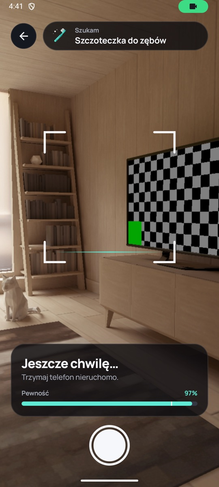 | 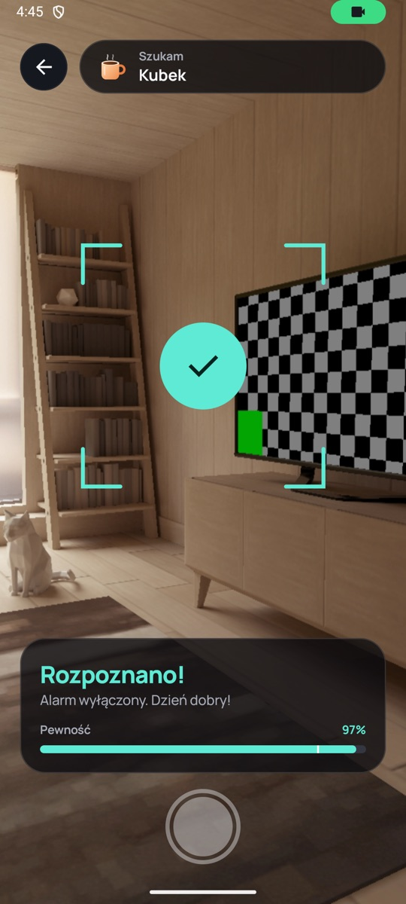 |

| Sukces | Wyjście awaryjne | Zadanie matematyczne | Brak zgody na kamerę |
|:---:|:---:|:---:|:---:|
| 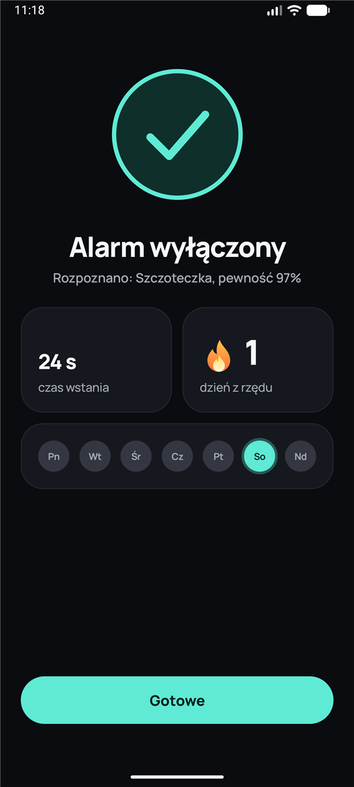 | 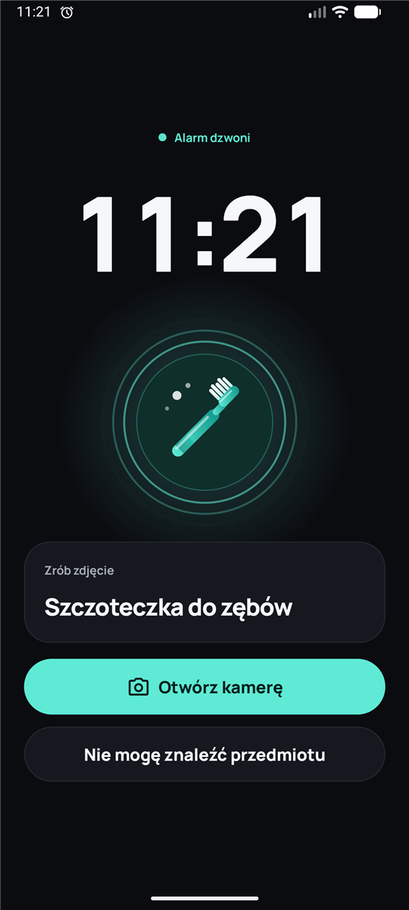 | 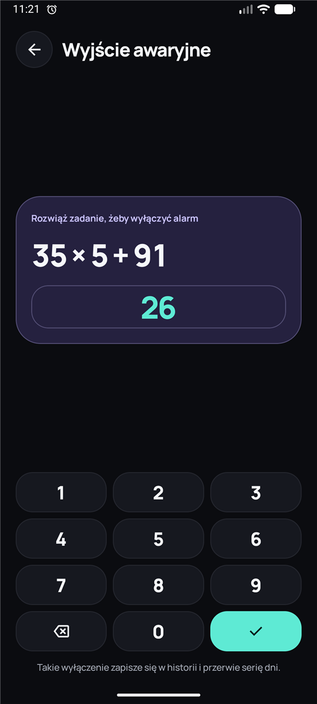 | 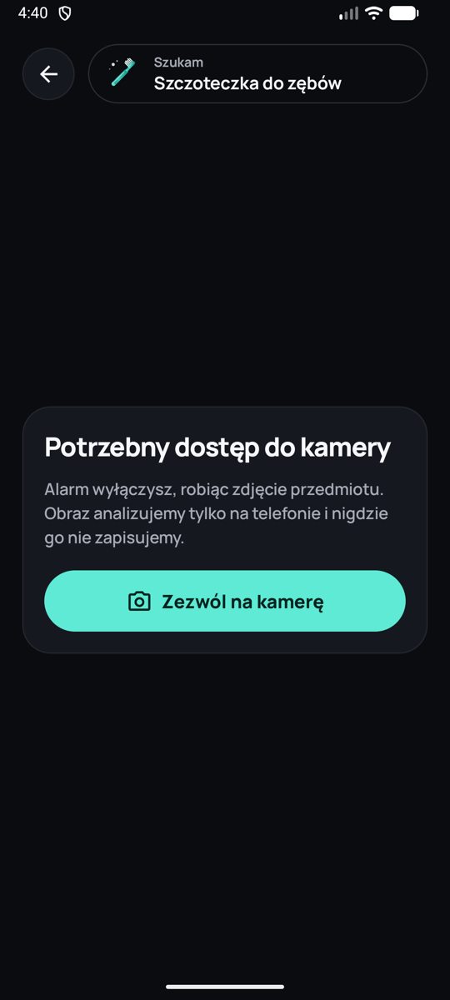 |

| Onboarding | Zgody w onboardingu | Historia | Przedmioty | Ustawienia | Tryb deweloperski |
|:---:|:---:|:---:|:---:|:---:|:---:|
| 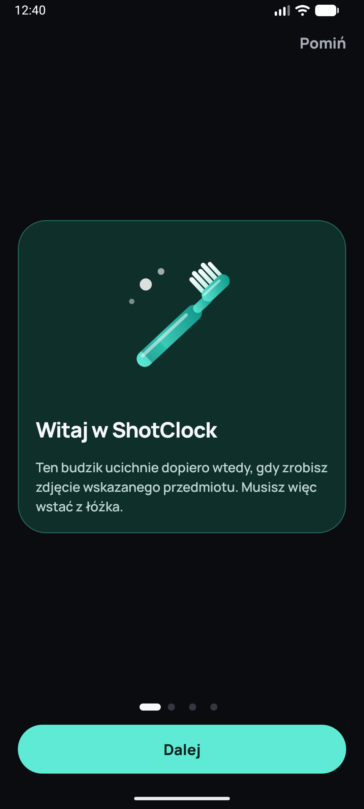 | 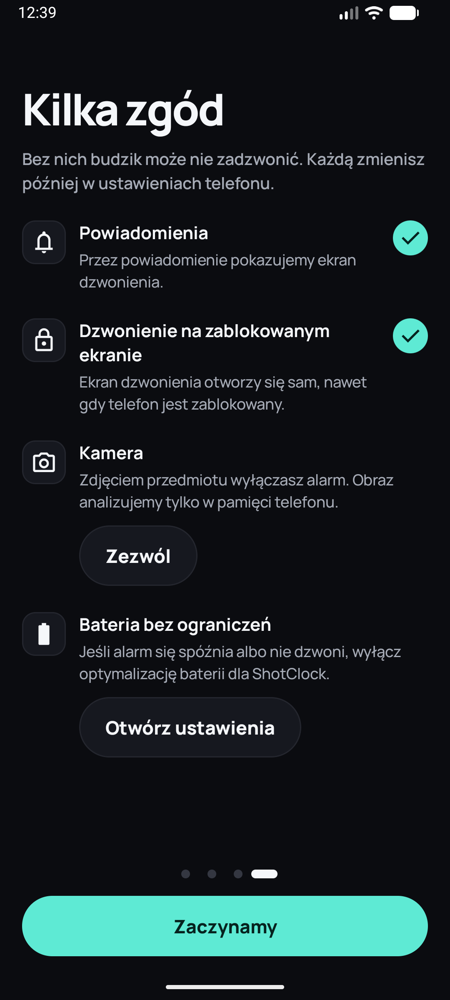 | 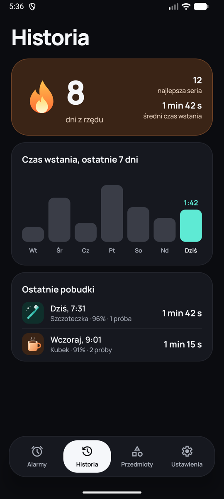 | 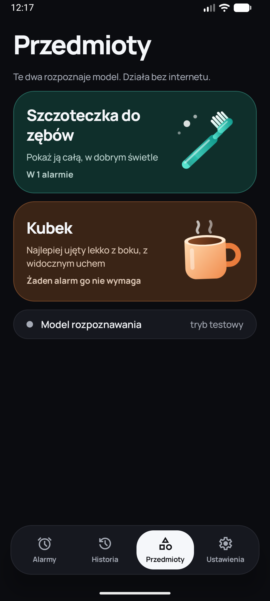 | 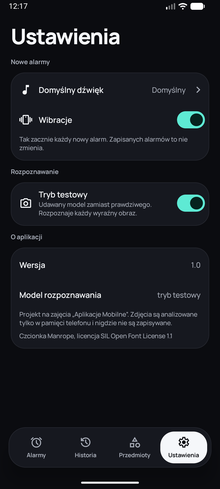 | 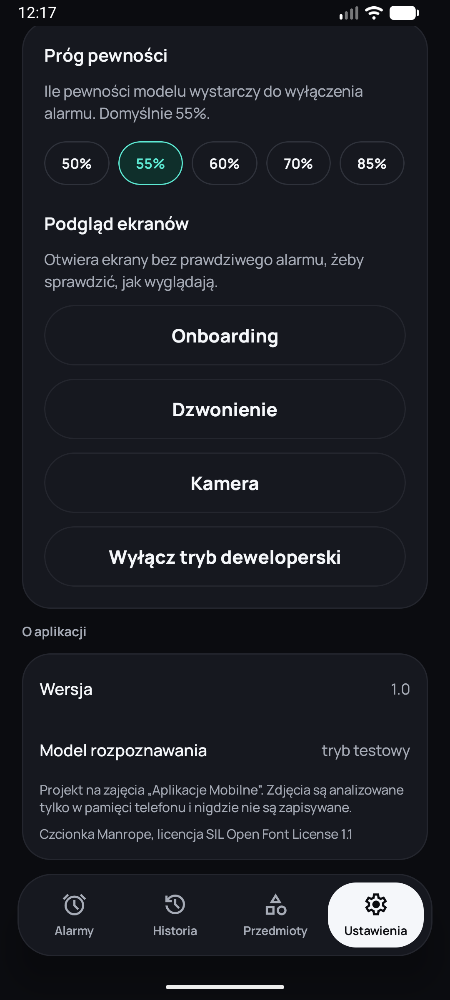 |

Zrzuty z emulatora Android Studio (kamera pokazuje wirtualny pokój emulatora). Wszystkie ekrany działają na prawdziwych danych. Rozpoznawanie jest na razie udawane przez `FakeObjectClassifier`, dopóki zespół AI nie dostarczy modelu.

## Jak to działa

1. Ustawiasz alarm: godzinę, dni tygodnia, etykietę i przedmiot, który trzeba będzie sfotografować (szczoteczka, kubek albo losowy).
2. Alarm dzwoni na pełnym ekranie, także przy zablokowanym telefonie. Na ekranie widać, jaki przedmiot trzeba znaleźć.
3. Otwierasz kamerę i celujesz w przedmiot. Model rozpoznaje go na żywo.
4. Gdy pewność rozpoznania przez około sekundę przekracza próg (domyślnie 55%, ustalony z prowadzącym na 50–60%), alarm się wyłącza, a aplikacja pokazuje czas wstania i serię dni z rzędu.
5. Jeśli przedmiotu nie da się znaleźć (po 10 nieudanych próbach albo 10 minutach), pojawia się wyjście awaryjne: zadanie matematyczne. Takie wyłączenie zapisuje się w historii.

## Funkcje

Stan na dziś: ✅ działa, 🧩 ekran gotowy na przykładowych danych, ⏳ w planie.

| Funkcja | Stan |
|---|---|
| Lista alarmów z kartami, przełącznikiem i informacją „Następny za 7 h 20 min” | ✅ |
| Dodawanie i edycja alarmu: przewijany wybór godziny, szybkie wybory dni („Dni robocze”, „Weekend”, „Codziennie”), etykieta, wybór przedmiotu, wibracje, narastająca głośność | ✅ |
| Usuwanie alarmu przesunięciem karty z opcją „Cofnij” | ✅ |
| Zapis alarmów w bazie SQLite (Room) | ✅ |
| Ciemny motyw, czcionka Manrope, pływający dolny pasek, animacje przejść | ✅ |
| Prawdziwe dzwonienie: AlarmManager, dźwięk z narastającą głośnością, wibracje, wybór dzwonka, powiadomienie pełnoekranowe (także na zablokowanym telefonie), przywracanie alarmów po restarcie i zmianie strefy czasowej | ✅ |
| Ekran dzwonienia z pulsującą poświatą wokół przedmiotu, bez drzemki | ✅ |
| Kamera (CameraX) z celownikiem, linią skanowania i półprzezroczystym panelem z podpowiedzią | ✅ |
| Rozpoznawanie na żywo co 400 ms z paskiem pewności. Alarm cichnie, gdy pewność przez 1 s jest powyżej progu 55% | ✅ (na `FakeObjectClassifier`) |
| Ręczne zdjęcie jako alternatywa (tylko w pamięci, bez zapisu na dysku) | ✅ |
| Prośba o dostęp do kamery z wyjaśnieniem, obsługą odmowy i przejściem do ustawień telefonu | ✅ |
| Ekran sukcesu po wyłączeniu alarmu: animacja ptaszka, czas wstania, seria dni z rzędu, udane dni w tym tygodniu | ✅ |
| Zapis każdej pobudki w bazie (`WakeEvent`): czas dzwonienia i wyłączenia, liczba prób, rozpoznany przedmiot, pewność | ✅ |
| Wyjście awaryjne „Nie mogę znaleźć przedmiotu” po 10 nieudanych zdjęciach albo 10 minutach dzwonienia: zadanie matematyczne na własnej klawiaturze, zapis w historii jako wyłączenie awaryjne | ✅ |
| Historia pobudek z bazy: seria dni, najlepsza seria, średni czas wstania, wykres z 7 dni, lista ostatnich pobudek (także awaryjnych) | ✅ |
| Ekran przedmiotów: liczba alarmów przy każdym przedmiocie i stan modelu (tryb testowy, brak modelu albo jego wersja) | ✅ |
| Ustawienia w DataStore: domyślny dźwięk i wibracje dla nowych alarmów, tryb testowy, informacje o aplikacji | ✅ |
| Ukryty tryb deweloperski (7 dotknięć wersji): wybór progu pewności i podgląd ekranów | ✅ |
| Onboarding przy pierwszym uruchomieniu: 3 karty z wyjaśnieniem i lista zgód (powiadomienia, dokładne alarmy, dzwonienie na zablokowanym ekranie, kamera, bateria) z obsługą odmowy i podpowiedzią dla Samsunga | ✅ |
| Płynność na starszym telefonie: obliczenia list poza wątkiem rysującym ekran, wersja release z R8 i Baseline Profile | ✅ |
| Prawdziwy model TensorFlow Lite od zespołu AI | ⏳ Etap 8 |

## Stos technologiczny

| Obszar | Technologia |
|---|---|
| Język | Kotlin |
| Interfejs | Jetpack Compose, Material 3 (z własnym ciemnym stylem), Navigation Compose |
| Architektura | MVVM: ViewModel + StateFlow, Kotlin Coroutines |
| Baza danych | SQLite przez Room (generowanie kodu przez KSP) |
| Ustawienia | DataStore Preferences |
| Kamera | CameraX 1.7 (`camera-camera2`, `camera-lifecycle`, `camera-view`) |
| AI / ML | Interfejs `ObjectClassifier` z udawanym `FakeObjectClassifier`; TensorFlow Lite / LiteRT *(Etap 8)* |
| Alarm | AlarmManager `setAlarmClock`, foreground service, full-screen intent |
| Wstrzykiwanie zależności | Ręcznie, przez klasę `AppContainer` (bez Hilta) |
| Testy | JUnit 4, AndroidX Test, kotlinx-coroutines-test |

Wymagania: **minimum Android 8.0 (API 26)**, aplikacja kompilowana pod API 37.

## Architektura

Aplikacja korzysta z wzorca **MVVM** (Model – View – ViewModel):

```
Ekran (Compose)  ──zdarzenia──▶  ViewModel  ──▶  Repozytorium  ──▶  Room (SQLite)
       ▲                             │
       └────────── StateFlow ◀───────┘
```

- **View** to funkcje `@Composable` w pakiecie `ui/`. Tylko rysują stan i przekazują kliknięcia dalej.
- **ViewModel** (pakiet `viewmodel/`, jeden na ekran) trzyma stan ekranu w `StateFlow` i decyduje, co zrobić po akcji użytkownika.
- **Model** to encje Room, DAO i repozytoria w pakiecie `data/`.
- **`AppContainer`** tworzy bazę i repozytoria raz, przy starcie aplikacji. `AppViewModelProvider` przekazuje je do ViewModeli.
- Logika bez zależności od Androida (np. obliczanie najbliższego alarmu w `alarm/NextAlarm.kt`) jest w osobnych, czystych funkcjach, żeby łatwo ją testować.

### Struktura pakietów

```
pl.shotclock.budzik
├── ui/
│   ├── theme/        kolory, typografia, kształty, powierzchnie, animacje
│   ├── components/   AppCard, AppButton, AppToggle, TimeDisplay, TimeWheel, ...
│   ├── onboarding/   powitanie + uprawnienia
│   ├── alarms/       lista alarmów
│   ├── edit/         dodawanie/edycja alarmu
│   ├── ring/         ekran dzwonienia
│   ├── camera/       ekran kamery z rozpoznawaniem
│   ├── objects/      przedmioty do rozpoznawania (ObjectVisual.kt: nazwa, ilustracja, kolor)
│   ├── history/      historia i statystyki pobudek
│   └── settings/     ustawienia
├── viewmodel/        jeden ViewModel na ekran
├── data/             Room (encje, DAO, baza), DataStore (ustawienia), repozytoria, statystyki pobudek
├── alarm/            planowanie, receiver, serwis dzwonienia, boot receiver, decyzja o wyłączeniu
├── camera/           obsługa CameraX: CameraSession (podgląd, klatki, zdjęcie), FrameAnalyzer
└── ml/               ObjectClassifier, FakeObjectClassifier, ModelInfo (TfliteObjectClassifier w Etapie 8)
```

### Model danych

- **`Alarm`** (tabela `alarms`, gotowa): id, godzina, minuta, dni tygodnia, włączony, etykieta, wymagany przedmiot (`FIRST`, `SECOND` albo `RANDOM`), dźwięk, wibracje, narastająca głośność.
- **`WakeEvent`** (tabela `wake_events`, gotowa): id alarmu, czas startu dzwonienia, czas wyłączenia, liczba prób, rozpoznany przedmiot, pewność, czy wyłączenie było awaryjne. Celowo bez klucza obcego do alarmu, żeby po usunięciu alarmu historia została.

Baza ma wersję 2. Przejście z wersji 1 (same alarmy) robi ręczna migracja `AppDatabase.MIGRATION_1_2`: dodaje pustą tabelę z historią, a zapisane alarmy zostają.

### Jak działa rozpoznawanie (Etap 4)

```
CameraX ──klatka co 400 ms──▶ FrameAnalyzer ──Bitmap──▶ CameraViewModel
                                                         │  ObjectClassifier.classify()  → pewność dla każdej klasy
                                                         │  decideDismiss()              → podpowiedź + czy wyłączyć
                                                         ▼
                                    ekran kamery (StateFlow)   RingController.dismiss() → cisza, okno się zamyka
```

- **`camera/CameraSession`** to cała obsługa CameraX w jednym miejscu: podgląd, analiza klatek (format RGBA, zawsze najnowsza klatka) i zdjęcie w pamięci. Najpierw tylna kamera, a gdy jej nie ma, przednia.
- **`camera/FrameAnalyzer`** przepuszcza jedną klatkę na 400 ms i obraca ją „do pionu”. Częstsza analiza nie daje nic, a grzałaby starszy telefon.
- **`ml/ObjectClassifier`** to interfejs. Ekrany i ViewModele nie wiedzą, czy pod spodem jest udawany, czy prawdziwy model.
- **`ml/FakeObjectClassifier`** udaje model: ciemny albo jednolity obraz (zasłonięta kamera, pusta ściana) to `inne`, a im więcej szczegółów na obrazie, tym większa pewność, że widzi szukany przedmiot. Dzięki temu na emulatorze i telefonie da się sprawdzić wszystkie podpowiedzi.
- **`alarm/DismissDecision.kt`** to czysta funkcja `decideDismiss` (bez Androida): szukany przedmiot + próg 0.55 + utrzymanie wyniku przez 1 s. Spadek pod próg zeruje licznik. Zwraca też podpowiedź: „Nie widzę przedmiotu”, „To inny przedmiot”, „Przybliż”, „Jeszcze chwilę…”, „Rozpoznano!”. Ręczne zdjęcie wystarczy, że raz przekroczy próg.
- Zdjęcia i klatki żyją tylko w pamięci jako `Bitmap`. Nic nie trafia na dysk ani do galerii.

### Jak przebiega pobudka (Etap 5)

```
            ┌──▶ Kamera ── rozpoznano ──────────────┐
Dzwonienie ─┤                                       ├──▶ RingViewModel: cisza + zapis WakeEvent ──▶ Ekran sukcesu
            └──▶ „Nie mogę znaleźć przedmiotu” ──▶ Zadanie matematyczne ── dobry wynik ──┘
                 (po 10 nieudanych zdjęciach albo 10 min)
```

- **`viewmodel/RingViewModel`** prowadzi całą pobudkę w oknie `RingActivity`. Alarm wyłącza się w jednym miejscu, niezależnie od tego, czy pomogło zdjęcie, czy zadanie. Od razu zapisuje pobudkę w bazie i dostaje z powrotem podsumowanie do ekranu sukcesu.
- **`alarm/RingController`** liczy nieudane ręczne zdjęcia. Z tego licznika i z czasu dzwonienia czysta funkcja `isEmergencyExitAvailable` (`alarm/EmergencyExit.kt`) decyduje, czy pokazać „Nie mogę znaleźć przedmiotu” na ekranie dzwonienia i kamery.
- **`alarm/MathTask.kt`** losuje zadanie typu `23 × 7 + 48` i sprawdza wynik. Zły wynik daje nowe zadanie, żeby nie dało się zgadywać. Alarm dzwoni, dopóki wynik nie będzie dobry.
- **`data/WakeStats.kt`** to czyste funkcje statystyk: czas wstania, seria dni i udane dni w tygodniu. **Seria** to liczba kolejnych dni z alarmem, w których każdą pobudkę zakończyło zdjęcie. Dzień bez alarmu (np. weekend bez budzika) serii nie przerywa, a wyłączenie awaryjne ją zeruje.
- **Ekran sukcesu** (`ui/ring/SuccessScreen.kt`) odwzorowuje makietę: ptaszek rysuje się w kółku, potem rozchodzą się fale i iskry, a karty wjeżdżają po kolei. Animacja czyta postęp dopiero przy rysowaniu, więc nie obciąża starszego telefonu.
- Ekran zadania ma własną klawiaturę numeryczną zamiast systemowej: działa tak samo na zablokowanym ekranie i nie zasłania zadania. Na niskim ekranie (360 × 640 dp) albo przy dużej czcionce da się go przewinąć.

### Historia, przedmioty i ustawienia (Etap 6)

```
Room: wake_events ──Flow──▶ HistoryViewModel ──summarizeHistory()──▶ ekran historii
Room: alarms      ──Flow──▶ ObjectsViewModel ──countAlarmsByObject()──▶ ekran przedmiotów
DataStore         ──Flow──▶ SettingsViewModel, ObjectsViewModel, CameraViewModel (próg), EditAlarmViewModel (domyślne)
```

- **Historia odświeża się sama.** `WakeEventDao.observeAll()` zwraca `Flow`, więc nowa pobudka pojawia się na liście bez przeładowania ekranu.
- **Statystyki** to dalej czyste funkcje w `data/WakeStats.kt`: `averageWakeUpSeconds` (tylko pobudki zakończone zdjęciem, bo awaryjne trwają ponad 10 minut i zawyżałyby średnią), `bestStreak` (najdłuższa seria w historii, liczona tak samo jak bieżąca) i `lastSevenDays` (siedem dni kończących się dziś, średnia z kilku pobudek jednego dnia, `null` dla dnia bez pobudki).
- **Ustawienia** (`data/AppSettings.kt`, `data/SettingsRepository.kt`) są w DataStore, nie w Room: to kilka pojedynczych wartości, a nie tabela. Domyślny dźwięk i wibracje dostaje każdy nowy alarm; zapisanych alarmów to nie zmienia.
- **Tryb testowy i model:** `ml/ModelInfo.kt` sprawdza, czy w `assets` są `model.tflite` i `labels.txt`. Czysta funkcja `classifierMode` decyduje: tryb testowy włączony → udawany model; wyłączony, ale brak plików → nadal udawany (ekran mówi „czeka na model”); pliki są i tryb wyłączony → prawdziwy model (Etap 8).
- **Tryb deweloperski** włącza się 7 dotknięciami wersji aplikacji, jak w ustawieniach Androida. Jest w nim próg pewności (50, 55, 60, 70 albo 85%) i przyciski podglądu ekranów. Wyłączenie trybu przywraca próg 55%, żeby nie został zmieniony „po cichu”. Pasek pewności na ekranie kamery rysuje kreskę w miejscu wybranego progu.

### Onboarding i płynność (Etap 7)

```
Pierwsze uruchomienie ──▶ 3 karty z wyjaśnieniem ──▶ Kilka zgód ──▶ „Zaczynamy” ──▶ lista alarmów
                          (przesuwane w bok)          (✓ albo przycisk)
```

- **Kiedy widać onboarding.** `viewmodel/AppStartViewModel` czyta raz przy starcie ustawienie `onboardingDone` z DataStore. Gdy go nie ma, aplikacja zaczyna od onboardingu, a po „Zaczynamy” zapisuje, że już go przejrzano. W trybie deweloperskim da się go otworzyć ponownie (Podgląd ekranów → Onboarding).
- **Które zgody.** Czysta funkcja `setupStepsFor(sdkInt)` (`alarm/SetupSteps.kt`) wybiera tylko te, które istnieją na danej wersji Androida: powiadomienia od Androida 13, dokładne alarmy tylko na Androidzie 12, dzwonienie na zablokowanym ekranie od Androida 14, a kamera i bateria zawsze.
- **Odmowa.** O powiadomienia i kamerę pytamy w okienku systemowym. Gdy ktoś odmówi „na stałe”, system już nie zapyta, więc przycisk zmienia się na „Otwórz ustawienia”. Po powrocie z ustawień lista sprawdza zgody jeszcze raz i pokazuje ✓.
- **Samsung.** One UI usypia aplikacje, żeby oszczędzać baterię, a uśpiony budzik może się spóźnić. Na Samsungu krok „Bateria bez ograniczeń” otwiera stronę aplikacji i mówi dokładnie, co wybrać (Bateria → Bez ograniczeń).
- **Płynność.** Pomiar na emulatorze (ten sam scenariusz: przełączanie zakładek, przewijanie, edycja alarmu; około 2050 klatek):

  | Wersja | Wolne klatki wątku UI | 99% klatek szybciej niż | Zimny start |
  |---|---|---|---|
  | debug | 25 | 48 ms | ok. 530 ms |
  | release (R8) | 4 | 32 ms | ok. 290 ms |
  | release + Baseline Profile | 4 | 32 ms | ok. 240 ms |

  Najważniejszy wniosek: **wersja debug jest dużo wolniejsza** (Android nie optymalizuje kodu, który da się debugować). Płynność sprawdzamy więc zawsze na wersji release. Do tego listy alarmów i historia liczą się w tle (`flowOn(Dispatchers.Default)`), a plik `app/src/main/baseline-prof.txt` każe Androidowi skompilować kod aplikacji z góry przy instalacji, więc pierwsze otwarcia ekranów nie przycinają. Animacje od początku czytają wartości wewnątrz `graphicsLayer` (`ui/theme/Motion.kt`), więc w każdej klatce zmienia się tylko rysowanie, bez przebudowy ekranu.

## Jak zbudować i uruchomić

Potrzebne:
- **Android Studio** (najnowsza stabilna wersja). Projekt używa Gradle 9.6 i JDK 25, które Android Studio pobiera i ustawia samo.
- Emulator albo telefon z Androidem 8.0 lub nowszym.

### W Android Studio

1. `File → Open` i wskaż folder repozytorium.
2. Poczekaj, aż Gradle pobierze zależności (pierwszy raz trwa to kilka minut).
3. Wybierz emulator albo podłączony telefon i kliknij **Run ▶**.

Do testów kamery na emulatorze ustaw w AVD `Camera → Back: Webcam0`, czyli kamerę laptopa. Domyślna scena wirtualna (`VirtualScene`) też działa: pokazuje pokój, który `FakeObjectClassifier` „rozpoznaje” po około sekundzie. Ekran kamery bez dzwoniącego alarmu otworzysz w trybie deweloperskim: `Ustawienia → O aplikacji → Wersja` (dotknij 7 razy), potem `Podgląd ekranów → Kamera` (wtedy nic się nie wyłącza).

### Z wiersza poleceń

```bash
./gradlew assembleDebug
```

```bash
./gradlew installDebug
```

Na macOS, jeśli systemowa Java jest w innej wersji niż wymagana, użyj JDK z Android Studio:

```bash
JAVA_HOME="/Applications/Android Studio.app/Contents/jbr/Contents/Home" ./gradlew assembleDebug
```

Gotowy plik APK znajdziesz w `app/build/outputs/apk/debug/`.

### Wersja do testów na telefonie (release)

Na starszym telefonie testuj **wersję release**: jest wyraźnie płynniejsza niż debug. W Android Studio wybierz `Build → Select Build Variant → release` i kliknij **Run ▶** albo z wiersza poleceń:

```bash
./gradlew installRelease
```

Release jest podpisany kluczem debug z Android Studio, więc instaluje się bez dodatkowej konfiguracji (projekt nie trafia do Google Play). Jeśli na telefonie jest już wersja debug, nie trzeba jej odinstalowywać: obie mają ten sam podpis.

## Testy

**Testy jednostkowe** (JUnit, uruchamiane na komputerze, bez telefonu):

```bash
./gradlew testDebugUnitTest
```

- `alarm/NextAlarmTest`: kiedy zadzwoni najbliższy alarm (alarm jednorazowy dziś albo jutro, dni robocze w piątek wieczorem, pomijanie niewybranych dni, wybór najwcześniejszego włączonego alarmu, „za ile” z zaokrągleniem minut).
- `alarm/RingTimeMillisTest`: dokładny moment dzwonienia, także przy zmianie czasu letniego.
- `alarm/ObjectPickerTest`: losowanie przedmiotu dla alarmu „losowego”.
- `alarm/RingVolumeTest`: narastanie głośności.
- `alarm/RingSoundTest`: wybór dźwięku (także easter egg 21:37).
- `alarm/DismissDecisionTest`: decyzja o wyłączeniu alarmu (próg 0.55, utrzymanie 1 s, zerowanie licznika po spadku, podpowiedzi „Nie widzę”, „Przybliż”, „To inny przedmiot”, ręczne zdjęcie).
- `alarm/EmergencyExitTest`: kiedy pojawia się wyjście awaryjne (10 nieudanych zdjęć albo 10 minut dzwonienia).
- `alarm/MathTaskTest`: wynik zadania, sprawdzanie odpowiedzi, zakres losowanych liczb.
- `viewmodel/EmergencyViewModelTest`: wpisywanie i kasowanie cyfr, limit 3 cyfr, dobra i zła odpowiedź.
- `data/WakeStatsTest`: czas wstania, seria dni (dwa alarmy jednego dnia, dzień bez alarmu, przerwanie serii wyłączeniem awaryjnym), udane dni w tygodniu.
- `data/WakeEventRepositoryTest`: zapis pobudki i podsumowanie dla ekranu sukcesu.
- `data/HistoryStatsTest`: średni czas wstania (bez wyłączeń awaryjnych), najlepsza seria, wykres z 7 dni (pusty dzień, dwie pobudki jednego dnia, pomijanie starszych pobudek).
- `alarm/SetupStepsTest`: które zgody pokazuje onboarding na Androidzie 8, 12, 13 i 14+, rozpoznanie Samsunga.
- `data/SettingsRepositoryTest`: ustawienia w prawdziwym DataStore w pliku tymczasowym: wartości domyślne (próg 55%), onboarding pokazywany do pierwszego „Zaczynamy”, zapis i odczyt, powrót do domyślnego dźwięku, przywrócenie progu po wyłączeniu trybu deweloperskiego, bezpieczny zakres progu.
- `viewmodel/SettingsAndObjectsTest`: odliczanie do trybu deweloperskiego, wybór udawanego albo prawdziwego modelu, liczba alarmów przy każdym przedmiocie.
- `ml/FakeObjectClassifierTest`: jasność i szczegóły obrazu, wyniki udawanego modelu (ciemno i pusto → `inne`, dużo szczegółów → szukany przedmiot, suma pewności = 1).
- `data/AlarmRepositoryTest`: repozytorium ustawia i odwołuje alarmy w systemie razem ze zmianami w bazie.
- `data/ConvertersTest`: zapis dni tygodnia w bazie i ich odczyt.

**Testy na urządzeniu** (Room na bazie w pamięci, potrzebny emulator albo telefon):

```bash
./gradlew connectedDebugAndroidTest
```

- `data/AlarmDaoTest`: zapis i odczyt wszystkich pól, sortowanie po godzinie, edycja, włączanie i wyłączanie, przywracanie usuniętego alarmu z tym samym id.
- `data/WakeEventDaoTest`: zapis pobudki zwykłej i awaryjnej (bez przedmiotu i pewności), sortowanie od najnowszej, lista obserwowana przez ekran historii.

W Etapie 8 dojdzie test modelu na zdjęciach testowych. Ręczne scenariusze na telefonie: alarm przy zablokowanym ekranie, po restarcie, w trybie samolotowym i przy słabym świetle.

## Kontrakt z zespołem AI

Aplikację buduje jedna osoba, a reszta zespołu zbiera zdjęcia (około 500 na przedmiot) i trenuje model. Do czasu dostarczenia modelu aplikacja korzysta z `FakeObjectClassifier`, który udaje rozpoznawanie. Podłączenie prawdziwego modelu to podmiana dwóch plików.

**Pliki:**
- `app/src/main/assets/model.tflite`: model TensorFlow Lite.
- `app/src/main/assets/labels.txt`: jedna etykieta w linii, w kolejności wyjść modelu.

**Klasy** (dokładnie te nazwy):

```
przedmiot_1
przedmiot_2
inne
```

Klasa `inne` jest obowiązkowa. Bez niej model „rozpozna” jako przedmiot cokolwiek, co zobaczy kamera.

**Wejście i wyjście:** model przyjmuje jeden obraz RGB i zwraca prawdopodobieństwo dla każdej klasy. `TfliteObjectClassifier` odczytuje rozmiar wejścia i typ danych (float32 albo uint8) z samego modelu, więc działa z modelem z Teachable Machine, MediaPipe Model Maker albo z własnym.

**W kodzie:**
- Etykiety `przedmiot_1` i `przedmiot_2` są przypisane do przedmiotów w `data/RequiredObject.kt`, a ich nazwy, ilustracje i kolory w `ui/objects/ObjectVisual.kt`. Obecnie to szczoteczka do zębów i kubek.
- Wynik klasyfikacji: `ClassificationResult(label: String, confidence: Float)` oraz pełna lista wyników.
- Próg pewności: domyślnie 0.55, czyli środek przedziału 50–60% ustalonego z prowadzącym (`DefaultConfidenceThreshold` w `alarm/DismissDecision.kt`). Da się go zmienić w trybie deweloperskim w ustawieniach.
- Wersja modelu pokazywana w aplikacji to stała `ModelFiles.VERSION` w `ml/ModelInfo.kt`. Przy każdym nowym pliku `model.tflite` warto ją podbić, żeby na demo było widać, który model działa.
- Tryb testowy w ustawieniach (domyślnie włączony) wymusza `FakeObjectClassifier`, nawet gdy prawdziwy model jest już w aplikacji. Przydaje się na demo, gdy światło jest słabe.
- Podmiana modelu: `AppContainer.createClassifier()` zwraca dziś `FakeObjectClassifier`. W Etapie 8 zwróci `TfliteObjectClassifier`, a reszta aplikacji się nie zmieni.

## Plan budowy

| Etap | Zakres | Stan |
|---|---|---|
| 1. Fundament | Zależności, struktura pakietów, `AppContainer`, ciemny motyw i komponenty z podglądami, nawigacja z dolnym paskiem, ekrany na przykładowych danych | ✅ gotowe |
| 2. Alarmy w bazie | Room, lista alarmów, edycja alarmu, usuwanie z „Cofnij”, testy DAO | ✅ gotowe |
| 3. Dzwonienie | AlarmManager, foreground service, narastająca głośność, wibracje, full-screen intent, boot receiver | ✅ gotowe |
| 4. Kamera | Uprawnienia, CameraX, celownik, analiza klatek z `FakeObjectClassifier`, decyzja o wyłączeniu + testy | ✅ gotowe |
| 5. Pełny scenariusz | Dzwonienie → kamera → sukces, zapis `WakeEvent`, wyjście awaryjne + testy | ✅ gotowe |
| 6. Historia, przedmioty, ustawienia | Statystyki, wykres, DataStore, tryb testowy, tryb deweloperski z progiem pewności + testy | ✅ gotowe |
| 7. Onboarding i dopracowanie | Onboarding ze zgodami i podpowiedzią dla Samsunga, płynność (release, Baseline Profile, obliczenia w tle), animacje, puste stany | ✅ gotowe |
| 8. Integracja modelu | `TfliteObjectClassifier`, pliki od zespołu AI, testy na zdjęciach | ⏳ |
| 9. Stabilizacja | Testy na Samsungu, wydajność, przygotowanie do demo | ⏳ |

## Projekt i zespół

Projekt zespołowy na przedmiot **„Aplikacje Mobilne”**, realizowany przez 4 osoby:
- **aplikacja i UI/UX:** jedna osoba buduje całą aplikację,
- **model AI:** trzy osoby zbierają zdjęcia i trenują model rozpoznawania.

Wymagania kursu, które aplikacja spełnia: Kotlin i Android Studio, minimum API 26, architektura MVVM, komponent sprzętowy (kamera, a przy alarmie także wibracje i głośnik), trwałe dane w SQLite, funkcja AI działająca lokalnie, testy oraz demo na fizycznym telefonie. Uzgodniony z prowadzącym zakres to 2 przedmioty do rozpoznawania.

Kod jest pisany tak, żeby był zrozumiały dla początkujących: komentarze po polsku tam, gdzie coś nie jest oczywiste, nazwy w kodzie po angielsku, wszystkie teksty interfejsu w `strings.xml`. Szczegółowe zasady pracy są w [CLAUDE.md](CLAUDE.md).

## Licencje

Czcionka **Manrope** (`app/src/main/res/font/manrope.ttf`) jest udostępniona na licencji **SIL Open Font License 1.1**. Pełna treść licencji: [licenses/Manrope-OFL.txt](licenses/Manrope-OFL.txt).
